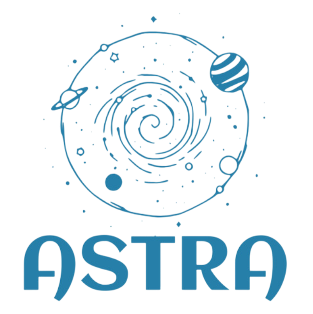
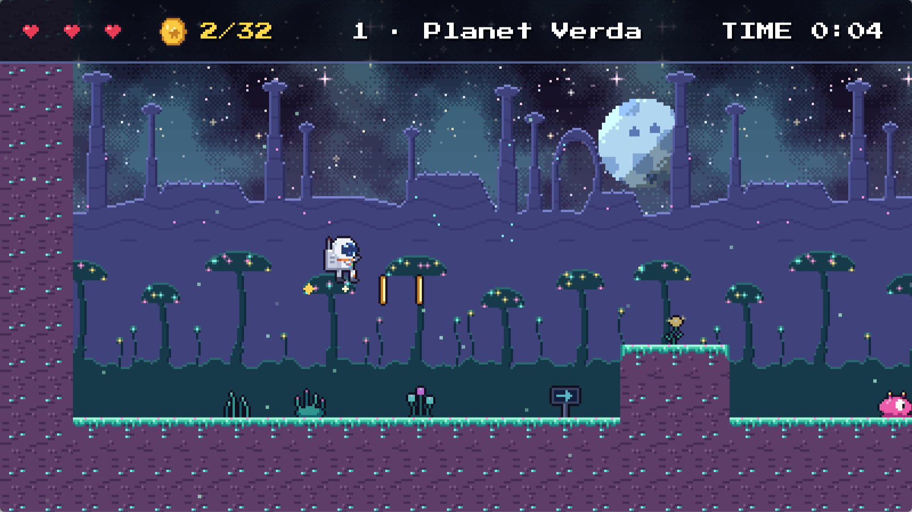
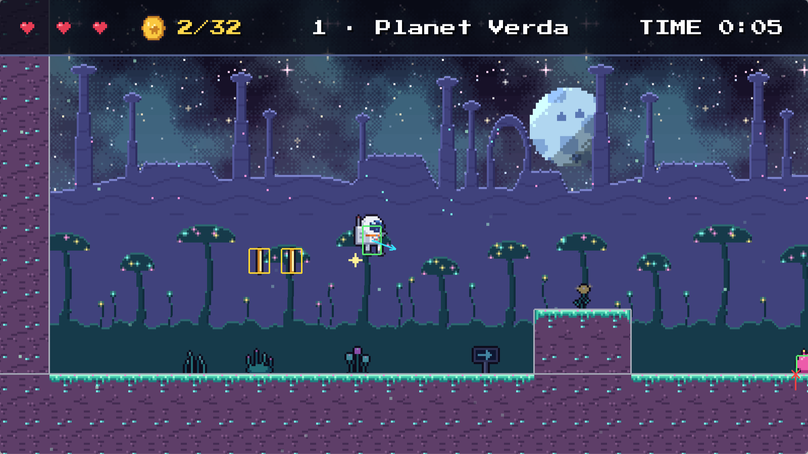

# Astra2D

<p align="center">
  
</p>

<p align="center">
  <a href="https://github.com/dulkaosmanovic/Astra2D/actions/workflows/ci.yml"></a>
  <a href="https://github.com/dulkaosmanovic/Astra2D/actions/workflows/docs.yml"></a>
  <a href="https://dulkaosmanovic.github.io/Astra2D/"></a>
  <a href="LICENSE"></a>
</p>

Astra2D is a modular 2D game engine written in C++20 on OpenGL 3.3 core. It is a university
diploma project about the architecture and core systems of a real-time game engine: rendering, an
entity component system, physics simulation and collision detection.

Astra2D is a library that games and tools are built on, not a single game. The **entity component
system and the physics engine are written from scratch**, without third-party engine libraries.
The project puts clean architecture, modularity, testability and measurable performance first.
Every design claim is backed by a benchmark (E1–E5) or a test.

<p align="center">
  
  
</p>
<p align="center"><em><b>Astra Run</b> (<code>examples/platformer</code>), the showcase game, and the same moment with the physics debug view (F3)</em></p>

---

## Quick start

On Arch Linux (other distributions: see [Getting started](https://dulkaosmanovic.github.io/Astra2D/getting-started.html)):

```bash
git clone --recurse-submodules https://github.com/dulkaosmanovic/Astra2D.git
cd Astra2D
./scripts/setup.sh                 # installs the compiler, Meson, Ninja and libraries; configures build/
ninja -C build                     # the engine, the tests and every example
./build/examples/platformer        # A/D run, Space jump, F3 physics view
meson test -C build                # the unit tests
```

Or with no local dependencies and no GPU, in Docker: `docker build -t astra2d . && docker run --rm astra2d`.

## What is inside

| Module | What it does |
|---|---|
| **core** | Application loop with a fixed timestep, window, input and action mapping, events, logging |
| **renderer** | Batched 2D renderer, camera with parallax, follow, shake and pixel-perfect mode, sprite animation, tile layers, aligned text, particles, post-processing |
| **assets** | Texture, shader and font loading with a cache and hot reloading |
| **ecs** | Sparse-set entity component system with views and signals |
| **physics** | Rigid bodies, three broad phases, SAT, an impulse solver, triggers, one-way platforms, tile maps, ray casts |
| **scene** | Scenes with systems, components, hierarchy, JSON scene files and Tiled maps |
| **audio** | Sound effects and music on miniaudio |
| **debug** | Physics debug view and frame statistics |

Around the engine: *Astra Run*, a complete platformer, ten smaller examples in `examples/`, 300+
unit tests, benchmarks E1–E5, CI with sanitizers and Valgrind, and a Docker image.

## Examples

`ninja -C build` builds them; run them from the repository root. Each shows how a part of the
engine is used, in one commented `main.cpp` in `examples/`:

| Example | Engine parts it uses |
|---|---|
| `hello_window` | `Application` and the main loop |
| `shapes`, `sprites`, `text` | `Renderer2D`, `OrthographicCamera`, `SpriteSheet` and animation, `Font` |
| `input` | `ActionMap` (keyboard and gamepad, rebinding), presses read in the fixed step, `EventDispatcher` |
| `post_processing` | `Framebuffer` render targets and `PostProcess` effects |
| `scene` | `Scene`, entities and systems, hierarchy, signals, scene files |
| `coin_collector` | A small game on the `Scene` with `PhysicsSystem` triggers and collisions, `Lifetime`, particles |
| `physics_playground` | The physics module: body types, stacks, bullets, one-way platforms, tile maps |
| `platformer` | **Astra Run**: every module together, from Tiled maps to physics events and audio ([guide](https://dulkaosmanovic.github.io/Astra2D/platformer_guide.html)) |
| `Sandbox`, `renderer_stress` | Hot reloading and parallax; the batcher under load (E1) |

## Key results

| | Question | Result |
|---|---|---|
| **E1** | Does sprite batching pay off? | 100,000 sprites in **10 draw calls instead of 100,000**, render time halved (56.7 → 27.9 ms) |
| **E2** | Is the ECS faster than OOP game objects? | At 1M objects **2.6× faster** than objects with a virtual `update()`, **5× faster** when the objects are scattered in memory; at 10k objects there is no real difference |
| **E3** | How much does a broad phase save? | At 5,000 bodies the uniform grid steps **68× faster** than brute force (0.92 vs. 62.4 ms), sort-and-sweep 40× |
| **E4** | Is the solver stable? | Towers of 5–20 boxes stand for 10 s with no sideways drift or rotation; a ball with restitution 1 keeps its energy within 2 % |
| **E5** | Is the API usable? | The whole platformer is 2,114 lines, 20 % of the engine's size; compared with raylib and Godot in the docs |


Tests cover 78 % of the engine's lines. Method and full tables: [Evaluation](https://dulkaosmanovic.github.io/Astra2D/evaluation.html).

## Documentation

**https://dulkaosmanovic.github.io/Astra2D/** has the getting-started guide (building, examples, your first game), the
architecture, a guide per module, the example game, the evaluation and the API reference. Build
it locally with `ninja -C build docs`.

## License

This project is licensed under the [MIT License](LICENSE). Vendored third-party code keeps its own
license: GLAD (MIT/Apache-2.0 generated code), stb_image and stb_truetype (public domain / MIT),
miniaudio (public domain / MIT-0).

The example font in `examples/assets/fonts/` is *Press Start 2P* by CodeMan38, licensed under the
SIL Open Font License 1.1 (`examples/assets/fonts/OFL.txt`). All other example assets (textures,
sounds, music and levels) are original and CC0, generated by `scripts/generate_assets.py` and
`scripts/generate_platformer_assets.py`.

---

## Author

**Đulka Osmanović**: diploma thesis (Diplomski rad)

- Thesis title: Razvoj 2D game engine-a pomoću C++ programskog jezika i OpenGL biblioteke
- University / faculty: Fakultet elektrotehnike
- Mentor: Emir Skejić
