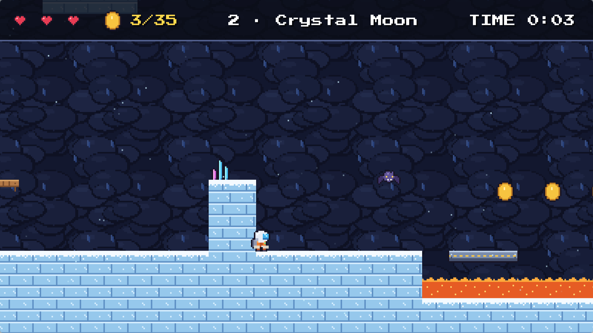
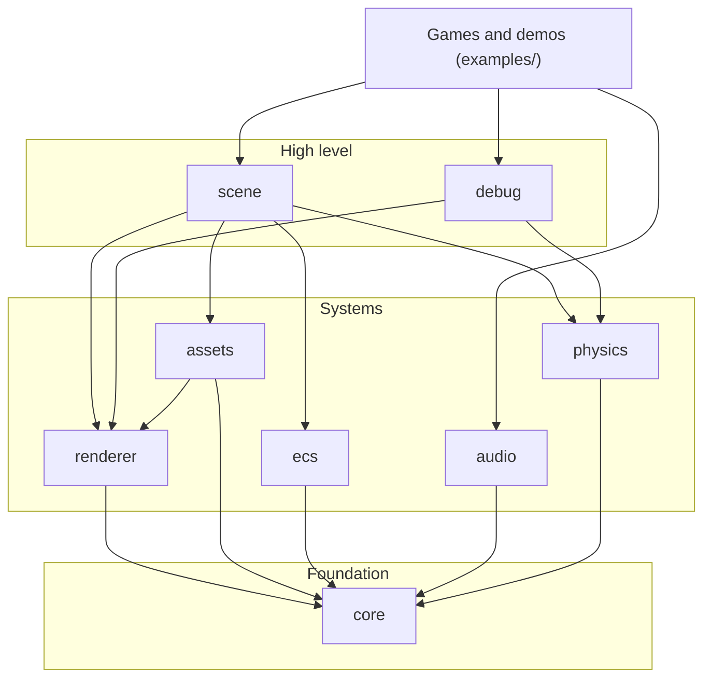
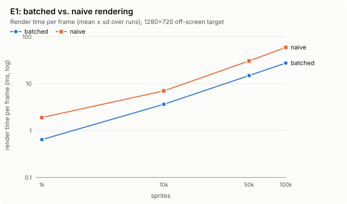
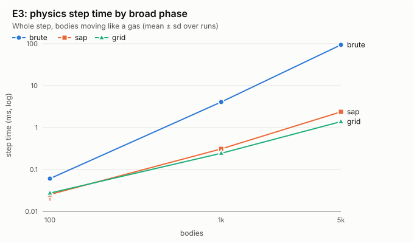
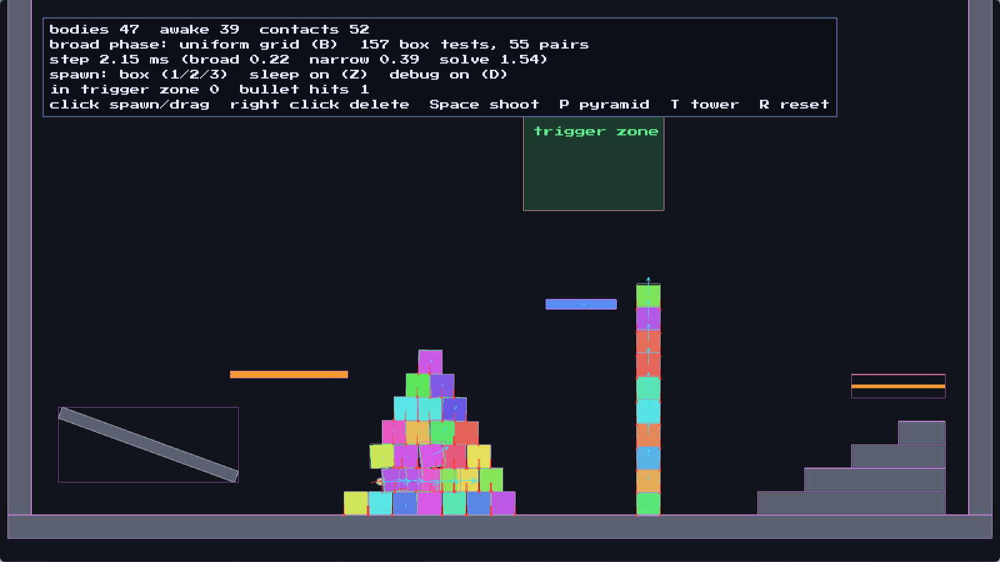

# Astra2D

<p align="center">
  
</p>

<p align="center">
  <a href="https://github.com/dulkaosmanovic/Astra2D/actions/workflows/ci.yml"></a>
  <a href="https://github.com/dulkaosmanovic/Astra2D/actions/workflows/docs.yml"></a>
  <a href="https://dulkaosmanovic.github.io/Astra2D/"></a>
  <a href="LICENSE"></a>
</p>

Astra2D is a modular 2D game engine written in C++20 on OpenGL 3.3 core. It is a university
diploma project about the architecture and core systems of a real-time game engine: rendering, an
entity component system, physics simulation and collision detection.

Astra2D is a library that games and tools are built on, not a single game. The **entity component
system and the physics engine are written from scratch**, without third-party engine libraries.
The project puts clean architecture, modularity, testability and measurable performance first.
Every design claim is backed by a benchmark (E1–E5) or a test.

<p align="center">
  
  
</p>
<p align="center"><em><b>Astra Run</b> (<code>examples/platformer</code>), the showcase game, and the same moment with the physics debug view (F3)</em></p>

---

## Contents

- [Quick start](#quick-start)
- [What is inside](#what-is-inside)
- [Key results](#key-results)
- [Examples](#examples)
- [Using the engine](#using-the-engine)
- [Making a game with Astra2D](#making-a-game-with-astra2d)
- [Building in detail](#building-in-detail)
- [Development](#development)
- [Repository structure](#repository-structure)
- [Documentation](#documentation) · [License](#license) · [Author](#author)

---

## Quick start

On Arch Linux (other distributions: see [Requirements](#requirements)):

```bash
git clone --recurse-submodules https://github.com/dulkaosmanovic/Astra2D.git
cd Astra2D
./scripts/setup.sh                 # installs the compiler, Meson, Ninja and the libraries
meson setup build
ninja -C build                     # the engine, the tests and every example
./build/examples/platformer        # A/D run, Space jump, F3 physics view
meson test -C build                # the unit tests
```

Or with no local dependencies and no GPU, in Docker: `docker build -t astra2d . && docker run --rm astra2d`
(see [Docker](#docker)).

---

## What is inside



A module uses only modules in its own or a lower layer. `ecs`, `physics` and `audio` do not touch
OpenGL, so they are unit-tested directly and run headless.

- **core**: application and main loop with a fixed timestep, window, keyboard, mouse and gamepad
  input, action mapping (`"jump" -> Space / A`), type-safe event dispatcher, logging and assertions.
- **renderer**: batched 2D renderer (coloured and textured quads, sprites, tiled backgrounds, text,
  debug lines, rectangles and circles), orthographic camera with rotation, parallax and trauma-based
  shake, sprite sheets and frame animation, render targets and post-processing effects, RAII
  OpenGL wrappers, render statistics.
- **assets**: texture, shader, effect and font loading with a cache and hot reloading.
- **ecs**: entities with generations, sparse-set component storage, registry, views that iterate
  the smallest pool, component add/remove signals.
- **physics**: rigid bodies (static, dynamic, kinematic) with circle, box and convex polygon shapes;
  brute force, sort-and-sweep and uniform grid broad phases; SAT narrow phase with two-point
  manifolds; sequential impulse solver with warm starting, a block solver for stable stacks,
  friction, restitution and split-impulse overlap removal; triggers, contact events, collision
  filtering, one-way platforms, island sleeping, continuous collision for bullets, tile map
  collision without ghost edges, ray casts. Deterministic.
- **scene**: scene with systems in a fixed order; Transform, SpriteRenderer, Animator, RigidBody,
  Collider and TilemapCollider components; parent/child hierarchy; sprite rendering by layer; JSON
  scene files; a PhysicsSystem connecting components to the physics world; Tiled map loading.
- **audio**: sound effects and music on miniaudio: overlapping voices with volume, pitch and pan,
  a voice limit, effect and music buses, mute. Runs without a sound device (tests, CI).
- **debug**: physics debug view (shapes coloured by body state, disabled tile edges, bounding
  boxes, contacts with normals, velocity arrows) and frame statistics (FPS, frame time
  min/mean/max, draw calls and quads per frame).

Around the engine: *Astra Run*, a complete platformer on the public API; ten smaller examples; 300+
unit tests; benchmarks E1–E5 with charts; CI with sanitizers, Valgrind, clang-format and
clang-tidy; a Docker image; a Doxygen site with a guide per module.

Every module of [PLAN.md](PLAN.md) is done. The stretch items left are an ImGui debug overlay, a
scoped CPU profiler and editor features.

### Technology

| Purpose | Library / tool |
|---|---|
| Language | C++20 |
| Graphics | OpenGL 3.3 core, GLAD, stb_image (textures), stb_truetype (fonts) |
| Window and input | GLFW |
| Math | GLM |
| Logging | spdlog |
| Scene files, Tiled maps | nlohmann/json |
| Audio | miniaudio |
| Build system | Meson + Ninja (system packages or Meson wraps) |
| Testing | GoogleTest, AddressSanitizer, UndefinedBehaviorSanitizer, Valgrind, gcov |
| Code quality | clang-format, clang-tidy, GitHub Actions, Docker |
| Documentation | Doxygen + doxygen-awesome-css |

---

## Key results

Measured in a release build; the full tables, method and machine are in
[benchmarks/results/summary.md](benchmarks/results/summary.md) and the documentation's
[Evaluation](https://dulkaosmanovic.github.io/Astra2D/evaluation.html) page.

| | Question | Result |
|---|---|---|
| **E1** | Does sprite batching pay off? | 100,000 sprites in **10 draw calls instead of 100,000**, render time halved (56.7 → 27.9 ms) |
| **E2** | Is the ECS faster than OOP game objects? | At 1M objects **2.6× faster** than objects with a virtual `update()`, **5× faster** when the objects are scattered in memory; at 10k objects there is no real difference |
| **E3** | How much does a broad phase save? | At 5,000 bodies the uniform grid steps **68× faster** than brute force (0.92 vs. 62.4 ms), sort-and-sweep 40× |
| **E4** | Is the solver stable? | Towers of 5–20 boxes stand for 10 s with no sideways drift or rotation; a ball with restitution 1 keeps its energy within 2 % |
| **E5** | Is the API usable? | The whole platformer is 1,508 lines, 15 % of the engine's size; compared with raylib and Godot in the docs |

Tests cover 78 % of the engine's lines, 90 % or more in the modules that do not use OpenGL.

<p align="center">
  
  
</p>

---

## Examples

`ninja -C build` builds every example. Run them from the repository root. Each is one commented
`main.cpp` in `examples/` (the platformer is split into a few files), so they double as a
tutorial; read them in this order:

| Example | Shows |
|---|---|
| `./build/examples/hello_window` | The smallest program: the application loop |
| `./build/examples/shapes` | Quads, lines, rectangles and circles; camera pan (drag) and zoom (wheel) |
| `./build/examples/sprites` | Textures, sprite sheets and frame animation (A/D walk) |
| `./build/examples/text` | Fonts, UTF-8 text in the world and on the screen |
| `./build/examples/input` | Action mapping, gamepads, rebinding at run time, game events |
| `./build/examples/post_processing` | Render targets and effects (1-4 switch, Tab low resolution) |
| `./build/examples/coin_collector` | A small complete game on the Scene/ECS: systems, triggers, collisions, states, score, lives, shake; F3 physics view, F2 frame statistics |
| `./build/examples/scene` | Entities and systems, hierarchy, signals, saving and loading scenes (F5/F9) |
| `./build/examples/physics_playground` | Spawn and drag bodies, stacks, bullets, one-way platforms, tile map, trigger zone; switch broad phase (B), debug draw (D), frame statistics (F2) |
| `./build/examples/platformer` | **Astra Run**: three levels (text map and Tiled maps), coins, crawlers, hazards, checkpoints, music. A/D run, Space jump, S+Space drop, P pause, M mute, F3 physics view, F2 frame statistics; `platformer 2` starts at level 2 |
| `./build/examples/Sandbox` | Everything at once: a Scene with interpolated movement, parallax, rotation, CRT effect, hot reloading |
| `./build/examples/renderer_stress` | Benchmark E1: thousands of sprites, batched or not (B, Up/Down, V) |

<p align="center">
  
</p>

---

## Using the engine

A game derives from `astra2d::Application` and overrides its hooks:

```cpp
#include <astra2d/core/application.hpp>

class MyGame : public astra2d::Application {
public:
    MyGame() : Application({ .window = { .title = "My Game", .width = 1280, .height = 720 } }) {}

protected:
    void onStart() override {}
    void onFixedUpdate(float fixedDeltaTime) override {}  // physics, 60 times per second
    void onUpdate(float deltaTime) override {}            // input, animation, once per frame
    void onRender() override {}
};

int main()
{
    MyGame game;
    game.run();
}
```

`ApplicationSettings` also sets the simulation rate (`fixedTimestep`, default 1/60 s) and the
longest frame time passed to the game (`maxFrameTime`, default 0.25 s).

**Drawing** goes through a camera and the batched `Renderer2D`:

```cpp
#include <astra2d/assets/asset_cache.hpp>
#include <astra2d/renderer/camera.hpp>
#include <astra2d/renderer/renderer2d.hpp>
#include <astra2d/renderer/sprite.hpp>

class MyGame : public astra2d::Application {
    astra2d::AssetCache m_assets{"assets"};
    astra2d::SpriteSheet m_sheet{m_assets.texture("textures/sprites.png"), {16, 16},
                                 /*margin*/ {1, 1}, /*spacing*/ {2, 2}};
    astra2d::OrthographicCamera m_camera{360.0F};   // 360 world units visible vertically
    astra2d::Renderer2D m_renderer;

    void onResize(int width, int height) override { m_camera.setViewportSize(width, height); }

    void onRender() override
    {
        m_renderer.begin(m_camera);
        m_renderer.drawQuad({0, 0}, {64, 64}, {0.2F, 0.6F, 1.0F, 1.0F});
        m_renderer.drawSprite({100, 0}, {32, 32}, m_sheet.frame(0));
        m_renderer.end();
    }
};
```

See the [renderer guide](https://dulkaosmanovic.github.io/Astra2D/renderer_guide.html) for the
camera, sprite animation and how batching works.

**Larger games** keep their objects as entities in a `Scene` and their logic in systems:

```cpp
#include <astra2d/scene/scene.hpp>

struct Spin { float speed; };   // a component: plain data

astra2d::Scene m_scene;

// In the constructor:
const astra2d::Entity sun = m_scene.createEntity("sun");            // has a Transform
m_scene.registry().emplace<astra2d::SpriteRenderer>(sun, astra2d::SpriteRenderer{.size = {64, 64}});
m_scene.registry().emplace<Spin>(sun, 0.5F);
const astra2d::Entity planet = m_scene.createEntity("planet", {150, 0});
m_scene.setParent(planet, sun);                                      // orbits with the sun

m_scene.addSystem(astra2d::SystemPhase::FixedUpdate, "spin", [](astra2d::Scene& scene, float dt) {
    scene.registry().view<astra2d::Transform, Spin>().each(
        [dt](astra2d::Transform& t, const Spin& s) { t.rotation += s.speed * dt; });
});

// In the hooks:
void onFixedUpdate(float dt) override { m_scene.fixedUpdate(dt); }
void onUpdate(float dt) override { m_scene.update(dt); }
void onRender() override { m_renderer.begin(m_camera); m_scene.render(m_renderer); m_renderer.end(); }
```

The [ECS guide](https://dulkaosmanovic.github.io/Astra2D/ecs_guide.html) explains sparse sets,
views, signals, the hierarchy and scene files.

**Physics** is added to a scene with a `PhysicsSystem`; entities get a `Collider` and, if they
move, a `RigidBody`:

```cpp
astra2d::PhysicsSystem m_physics{m_scene}; // a member after the scene

const auto crate = m_scene.createEntity("crate", {0.0F, 5.0F});
m_scene.registry().emplace<astra2d::RigidBody>(crate);
m_scene.registry().emplace<astra2d::Collider>(crate); // a 1x1 box; without RigidBody: static
m_physics.onCollisionBegin().connect([](const astra2d::CollisionEvent& e) { /* e.a hit e.b */ });
```

The [physics guide](https://dulkaosmanovic.github.io/Astra2D/physics_guide.html) explains the
broad and narrow phase, the solver, one-way platforms, tile maps and bullets.

---

## Making a game with Astra2D

A game lives in its own repository and uses the engine as a library; the engine is not copied
into the game. A typical layout:

```text
mygame/
├── meson.build              # dependency('astra2d'), the game executable, its assets
├── subprojects/astra2d.wrap # where Meson gets the engine (or a git submodule in subprojects/astra2d)
├── src/main.cpp             # class MyGame : public astra2d::Application
└── assets/                  # the game's own textures, shaders, fonts
```

```meson
project('mygame', 'cpp', default_options : ['cpp_std=c++20'])

astra2d_dep = dependency('astra2d')   # from subprojects/
executable('mygame', 'src/main.cpp', dependencies : astra2d_dep, install : true)
install_subdir('assets', install_dir : get_option('bindir'))
```

The dependency brings the engine library, its headers (`#include <astra2d/...>`), GLFW, GLM,
spdlog and the GLAD OpenGL loader. Your project must use C++20, because the public headers do.
When Astra2D is a subproject, its tests, examples and docs target are not built, so GoogleTest is
not needed. Enable them with `-Dastra2d:tests=enabled` or `-Dastra2d:examples=enabled`.

**Assets belong to the game, not to the engine.** The engine only loads files. Its own shaders are
compiled into the library, so a game needs no files from the engine at run time. The textures and
fonts in `examples/assets/` are there only for the examples. A shipped game finds its `assets/`
next to its executable with `astra2d::executableDirectory()`, and falls back to the source tree
during development:

```cpp
#include <astra2d/core/paths.hpp>

astra2d::AssetCache assets(astra2d::findDirectory(
    {astra2d::executableDirectory() / "assets", GAME_SOURCE_ASSETS_DIR}));
```

In `meson.build`, pass the development path with
`cpp_args : ['-DGAME_SOURCE_ASSETS_DIR="' + meson.current_source_dir() / 'assets' + '"']`.
`meson install` places the executable and `assets/` side by side, ready to copy to another
machine. That machine needs GLFW, spdlog and fmt, unless the game is configured with
`--wrap-mode=forcefallback -Ddefault_library=static`, which links them into the executable.

Inside this repository, the examples use `engine_dep` directly, as `examples/meson.build` does.

---

## Building in detail

### Requirements

- Linux with an OpenGL 3.3 capable GPU and driver
- GCC 13+ or Clang 17+ (C++20 with `<format>`), Meson 1.1+, Ninja
- Optional: Doxygen and Graphviz (documentation), Valgrind

On Arch Linux, `./scripts/setup.sh` installs everything. On other distributions, install a
compiler, Meson and Ninja; Meson downloads the missing libraries (GLFW, GLM, spdlog, GoogleTest)
from the wraps in `subprojects/`.

The documentation theme is a git submodule. In a clone made without `--recurse-submodules`, run
`git submodule update --init`.

### Build variants

```bash
meson setup build -Db_sanitize=address,undefined   # debug build with sanitizers
meson setup build-release --buildtype=release       # optimized build (benchmarks)
meson setup build-valgrind -Db_sanitize=none        # for Valgrind (cannot be combined with ASan)
meson setup build-wraps --wrap-mode=forcefallback   # use only Meson wraps, ignore system libraries
```

Add `-Dwerror=true` to treat compiler warnings as errors, as CI does. The tests, examples and
benchmarks can be turned off with `-Dtests=disabled`, `-Dexamples=disabled` and
`-Dbenchmarks=disabled` (see `meson.options`).

```bash
meson test -C build      # unit tests
ninja -C build docs      # documentation into build/docs/html
```

---

## Development

### Benchmarks

Run them in a release build on an otherwise idle machine. Each script writes CSV files and a
description of the machine to `benchmarks/results/`; [benchmarks/README.md](benchmarks/README.md)
describes the method and the columns.

| Script | Evaluation |
|---|---|
| `scripts/bench_renderer.sh` | E1: batched vs. one draw call per sprite, 1k to 100k sprites (keep the window visible) |
| `scripts/bench_ecs.sh` | E2: ECS vs. OOP game objects with a virtual `update()`, 10k to 1M objects |
| `scripts/bench_physics.sh` | E3: brute force vs. sort-and-sweep vs. uniform grid, 100 to 5000 bodies; E4: drift of box towers, energy of a bouncing ball (headless) |
| `scripts/bench_usability.py` | E5: lines of code of the engine, the tests and every example; which engine types the platformer uses |
| `scripts/make_charts.py` | Charts in `docs/images/evaluation/` and tables in `benchmarks/results/summary.md` from all CSV files |
| `scripts/bench_all.sh` | All of the above in one go (about ten minutes) |

### Test coverage

```bash
python3 scripts/coverage.py   # configures build-cov, runs the tests, prints coverage per module
```

Needs only GCC's `gcov`. The table is written to `benchmarks/results/coverage.csv` and discussed
in [docs/evaluation.md](docs/evaluation.md).

### Running under Valgrind

```bash
ninja -C build-valgrind
valgrind --leak-check=full ./build-valgrind/tests/engine_tests --gtest_filter='-*DeathTest*'
```

### Code style and static analysis

Formatting is defined in [`.clang-format`](.clang-format) and static analysis in
[`.clang-tidy`](.clang-tidy), which lists every disabled check with the reason. Both are checked in
CI; run the same check locally with:

```bash
scripts/docker-entrypoint.sh lint     # clang-format --dry-run --Werror + clang-tidy, fails on any finding
clang-format -i src/core/window.cpp   # reformat a file (most editors can do this on save)
```

CI takes clang from the Docker image's package snapshot, because clang-format output can change
between versions. `// NOLINT(check): reason` suppresses a single clang-tidy finding; always give
the reason.

### Docker

The `Dockerfile` provides a reproducible environment: Arch Linux pinned to a dated package
snapshot, with OpenGL through Mesa's software renderer on a virtual display, so no local
dependencies or GPU are needed.

```bash
git submodule update --init                         # the docs theme must be present before the image is built
docker build -t astra2d .
docker run --rm astra2d                             # build with ASan + UBSan and run the tests (default)
docker run --rm astra2d valgrind                    # unit tests under Valgrind (build without sanitizers)
docker run --rm astra2d release                     # optimized build
docker run --rm astra2d lint                        # clang-format + clang-tidy
docker run --rm astra2d sandbox 10                  # run the sandbox for 10 s and every example briefly (default 5)
docker run --rm astra2d all                         # all of the above
docker run --rm -v "$PWD/site:/out" astra2d docs    # generate the documentation into ./site
docker run --rm -it astra2d shell                   # interactive shell
```

The project is built once while the image is built, so a broken build already fails
`docker build`. The same commands work without Docker on a Linux host with the same tools, e.g.
`scripts/docker-entrypoint.sh all`; `sandbox` then uses the real display if one is available.

### Continuous integration

GitHub Actions ([`.github/workflows/ci.yml`](.github/workflows/ci.yml)) runs on every push to
`main` and on every pull request:

- GCC and Clang with ASan + UBSan, and a GCC release build, all with `-Dwerror=true`;
- the unit tests in each of them, plus smoke tests of every example
  (`scripts/docker-entrypoint.sh sandbox`) on Xvfb with Mesa's software renderer, which exercise
  the real window, OpenGL context and main loop;
- the unit tests under Valgrind;
- `clang-format` and `clang-tidy` (`scripts/docker-entrypoint.sh lint`) in an Arch Linux container
  pinned to the same package snapshot as the Dockerfile.

The documentation workflow fails on any Doxygen warning and publishes the docs from `main`.

---

## Repository structure

```text
Astra2D/
├── include/astra2d/  # Public engine API, one folder per module
├── src/              # Engine implementation
├── examples/         # Example programs, from hello_window to the platformer, and their assets/
├── tests/            # Unit tests (GoogleTest)
├── benchmarks/       # Headless benchmark programs and their results (CSV, summary.md)
├── docs/             # Doxygen configuration, guides, screenshots and evaluation charts
├── scripts/          # Setup, benchmark, chart, coverage and asset generation scripts
├── external/         # Vendored code (GLAD, stb, miniaudio, docs theme)
├── subprojects/      # Meson wrap files for dependencies
├── .github/          # CI and documentation workflows
├── Dockerfile        # Reproducible build and test environment
├── PLAN.md           # Development plan and status
├── meson.build
├── meson.options     # Build options (tests, examples, benchmarks)
├── .clang-format     # Code formatting rules
└── .clang-tidy       # Static analysis checks
```

---

## Documentation

Documentation is published at **https://dulkaosmanovic.github.io/Astra2D/** on every push to
`main`. To generate it locally, run `ninja -C build docs` and open `build/docs/html/index.html`.

It contains a [getting-started guide](https://dulkaosmanovic.github.io/Astra2D/getting-started.html),
the [architecture](https://dulkaosmanovic.github.io/Astra2D/architecture.html) overview, a guide
per module ([core](https://dulkaosmanovic.github.io/Astra2D/core_guide.html),
[renderer](https://dulkaosmanovic.github.io/Astra2D/renderer_guide.html),
[ECS and scenes](https://dulkaosmanovic.github.io/Astra2D/ecs_guide.html),
[physics](https://dulkaosmanovic.github.io/Astra2D/physics_guide.html),
[audio](https://dulkaosmanovic.github.io/Astra2D/audio_guide.html),
[debug](https://dulkaosmanovic.github.io/Astra2D/debug_guide.html)), the
[example game](https://dulkaosmanovic.github.io/Astra2D/platformer_guide.html), the
[evaluation](https://dulkaosmanovic.github.io/Astra2D/evaluation.html), a
[comparison with raylib and Godot](https://dulkaosmanovic.github.io/Astra2D/comparison.html) and
the API reference.

---

## License

This project is licensed under the [MIT License](LICENSE). Vendored third-party code keeps its own
license: GLAD (MIT/Apache-2.0 generated code), stb_image and stb_truetype (public domain / MIT),
miniaudio (public domain / MIT-0).

The example font in `examples/assets/fonts/` is *Press Start 2P* by CodeMan38, licensed under the
SIL Open Font License 1.1 (`examples/assets/fonts/OFL.txt`). All other example assets (textures,
sounds, music and levels) are original and CC0, generated by `scripts/generate_assets.py` and
`scripts/generate_platformer_assets.py`.

---

## Author

**Đulka Osmanović**: diploma thesis (Diplomski rad)

- Thesis title:
- University / faculty:
- Mentor:
