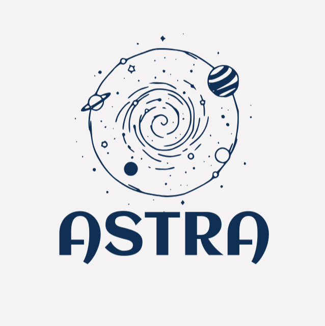

# 2D Game Engine

<p align="center">
  
</p>

2D Game Engine is a modular 2D game engine written in modern C++ using OpenGL.  
The project is being developed as a university diploma project focused on learning and implementing real-world game engine architecture, rendering systems, physics simulation, collision detection, and modern software engineering practices.

The engine is designed as a reusable framework for creating 2D games and interactive applications. Its goal is not only to render graphics, but also to provide the core systems commonly found in professional engines such as entity management, scene organization, input handling, physics, asset management, debugging tools, and developer utilities.

Unlike a single standalone game project, 2D Game Engine is structured as a separate engine library that can be used to build multiple games and tools on top of it. The project emphasizes clean architecture, modularity, maintainability, and modern C++ design principles.

The engine currently uses:
- C++
- OpenGL
- GLFW
- GLAD
- GLM
- Meson build system

Additional tooling and libraries are integrated to improve development workflow, debugging, testing, and documentation.

---

## Project Goals

The purpose of this project is to explore and implement the fundamental systems behind a real-time 2D game engine, including:

- rendering and graphics pipelines
- entity component systems (ECS)
- physics and collision detection
- resource and asset management
- engine modularity
- debugging and profiling tools
- testing and documentation
- reusable engine architecture

The project also serves as a practical study of low-level graphics programming and software architecture in C++.

---

## Current State

The engine is currently under active development.

Planned systems and features include:
- 2D renderer
- sprite rendering
- orthographic camera
- physics engine
- collision detection
- ECS architecture
- input system
- logging system
- debugging tools
- editor utilities
- scene management
- asset loading
- testing framework
- documentation generation

Additional features may be added during development depending on project scope and available time.

---

## Repository Structure

```text
Mini2DEngine/
├── include/      # Public engine API
├── src/          # Engine implementation
├── examples/     # Example applications and sandbox
├── tests/        # Unit and integration tests
├── docs/         # Documentation configuration
├── scripts/      # Development and setup scripts
├── external/     # Third-party libraries
├── assets/       # Textures, shaders, fonts, and resources
└── meson.build
```

---

## Building the Project

> Placeholder for installation instructions.

This section will later contain:
- dependency installation
- Meson setup
- build instructions
- debug/release builds
- platform-specific notes

---

## Running the Engine

> Placeholder for runtime instructions.

This section will later explain:
- how to launch the sandbox application
- how to run example projects
- debugging workflows
- configuration options

---

## Using the Engine

> Placeholder for engine usage documentation.

Future documentation will include:
- creating projects with the engine
- rendering sprites
- creating entities and components
- physics setup
- scene management
- asset loading
- scripting and tooling

---

## Documentation

The project uses Doxygen for API documentation generation.

Detailed documentation will be added as engine systems are implemented.

---

## Development Tools

The project integrates several development and debugging tools, including:
- GoogleTest
- Doxygen
- AddressSanitizer
- Valgrind
- spdlog
- clang-format
- clang-tidy

These tools are used to improve code quality, maintainability, testing, and debugging.

---

## License

This project is licensed under the MIT License.

---

## Author

Developed as a university diploma project in computer graphics and software engineering.
